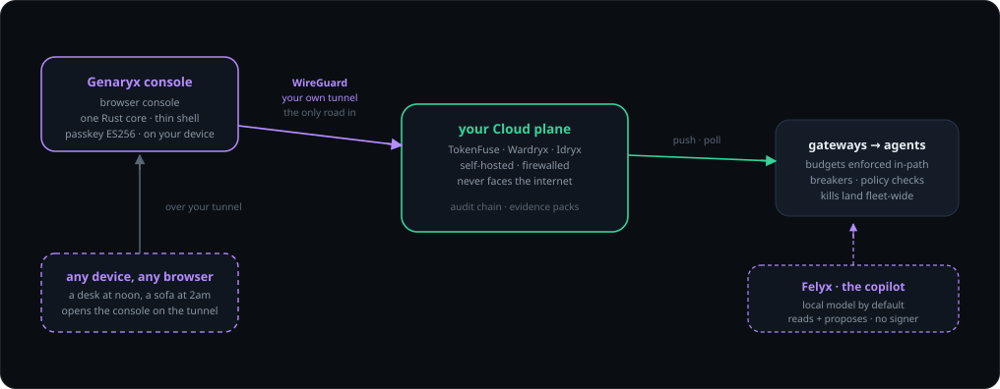
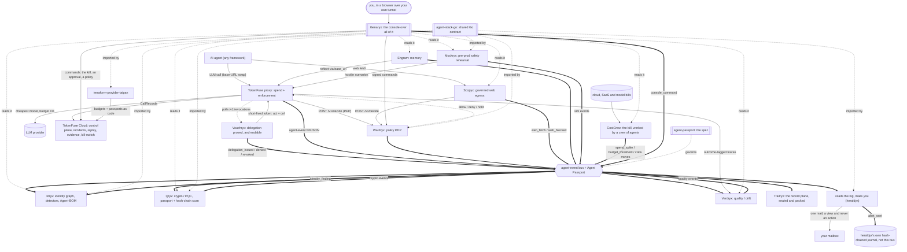
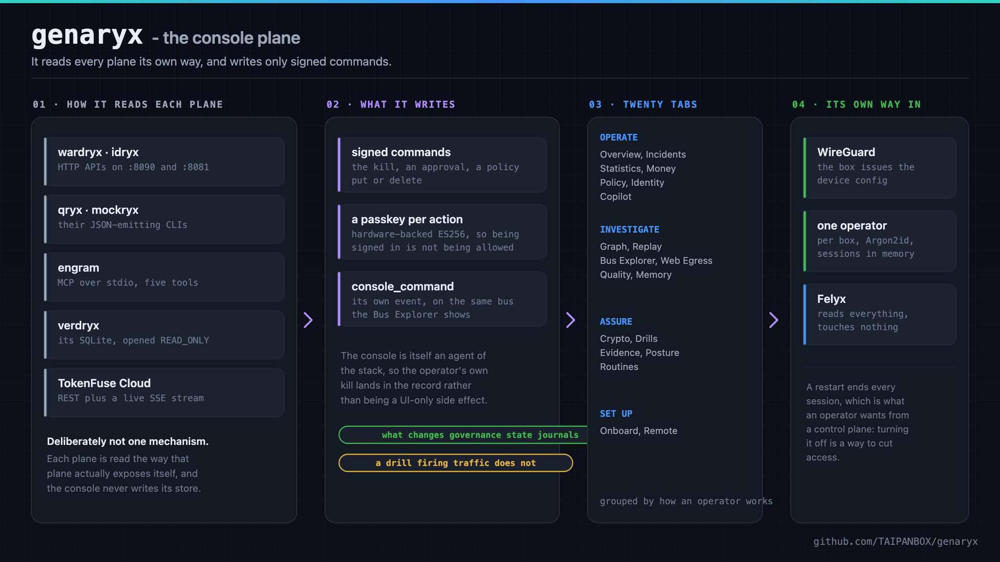
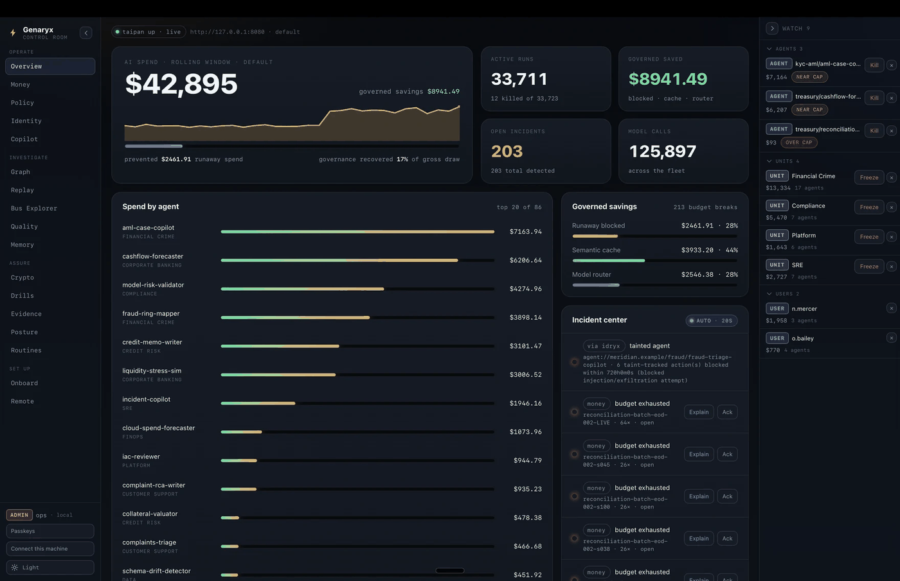
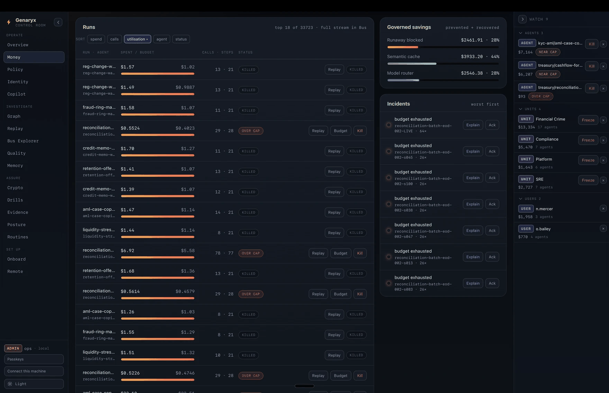
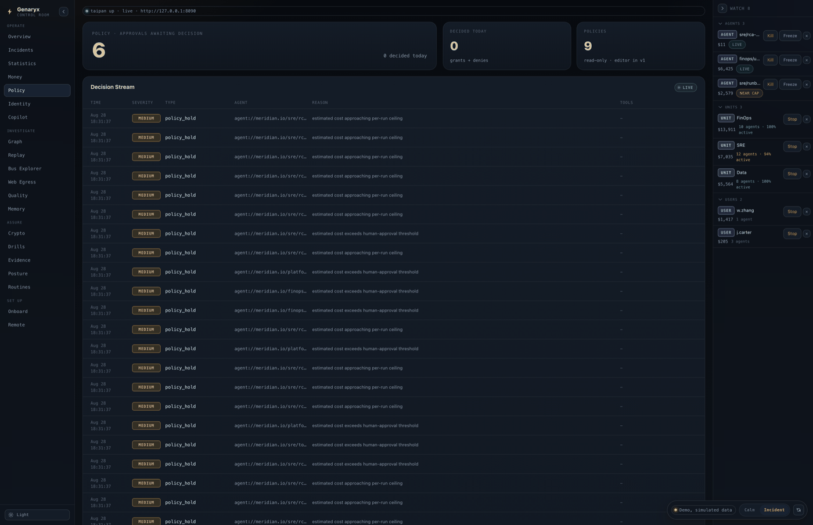
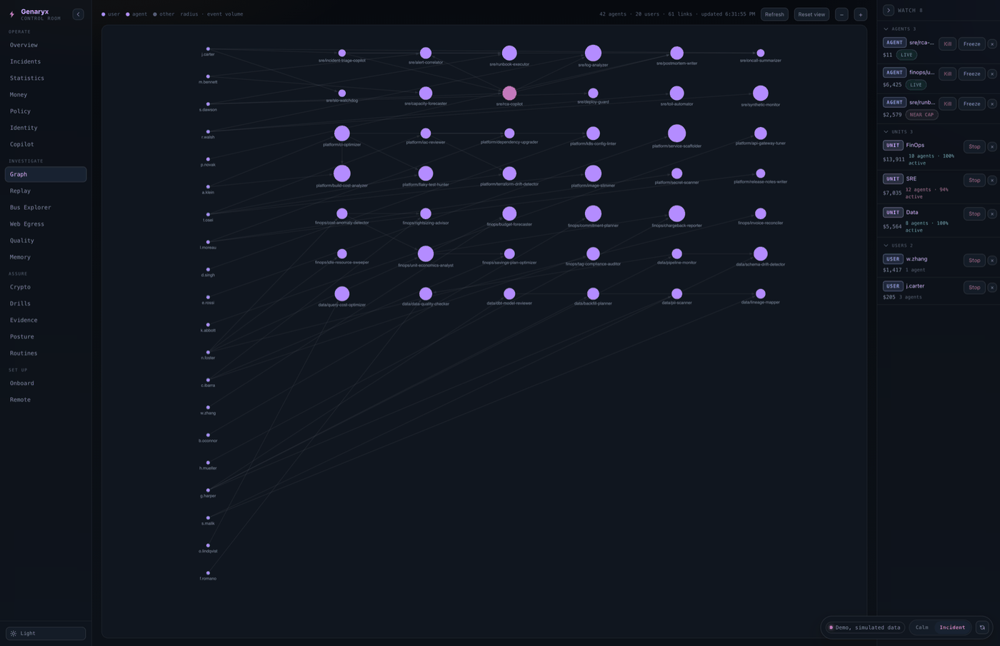

# Genaryx


The **control room** over the TAIPANBOX agent-governance stack: one window over
TokenFuse, Wardryx, Engram, Idryx, Qryx, Verdryx and Mockryx, running on your own
infrastructure and opened in a browser.

> **Apache-2.0**, like every other repository in the stack. See [LICENSE](LICENSE).

This repository was closed until **2026-07-27** and opened under Apache-2.0
with its history intact. A repository that changes licence owes the reader an
honest note rather than a badge, so here are the three things worth knowing
before you read further.

- **Parts of `docs/` are older than the licence.** Several design documents
  were written under the earlier model and still argue from it. They are left
  as they were written rather than quietly edited, because they record how the
  thing was built and when each decision was made. Read them as history; the
  code is the present tense.
- **The history is here, minus some media files.** Everything up to the flip is
  preserved. Screenshots carrying a pairing QR (a torn-down address and two
  one-time codes that expired in 274 seconds on 2026-07-20) and screen
  recordings from the same session were removed before publication. Nothing
  else was rewritten, and no credential, key or certificate has ever been
  committed here; that was verified across every commit before publication.
- **The licence gate is gone, the ML-DSA verifier is not.** A module that
  always granted and printed a TODO guarded a product nobody sells; it was
  deleted on 2026-07-27. The post-quantum verifier in `crates/signing` stayed:
  Genaryx never signs with ML-DSA, Qryx does, and this crate verifies what Qryx
  signed, which is a capability rather than a licence check.

## What it is

A real-time surface for whoever answers for a fleet of agents: burn and kill switch
(**TokenFuse**), policy decisions and approvals (**Wardryx**), identity graph
(**Idryx**), crypto posture and evidence (**Qryx**), quality and cost-per-outcome
(**Verdryx**), fire-drills (**Mockryx**), and memory (**Engram**). No new backend:
the console is a privileged consumer of the per-service NDJSON event bus plus a
client of the existing HTTP APIs.

The product is **a web console served from the customer's own box**
(`genaryx-web`): the runtime and the console both run inside the customer's
perimeter, reached over the operator's own WireGuard tunnel (D11). Nothing
about their runs, spend or identities travels anywhere to be displayed, and
it-rat.com has no route to the console at all.

<div align="center">



<sub>The console as its room on <a href="https://it-rat.com/genaryx.html">it-rat.com</a> draws it: the
control plane never faces the internet, and Felyx holds no signing key.</sub>

</div>

---

## Where this fits in the stack

Genaryx is the console plane of the TAIPANBOX agent-governance stack, and it is
the operator's way IN: the counterpart to heraldyx, which is the stack's way out
to a mailbox and is explicitly a view that never acts. This one acts, which is
why every write it makes is a command, signed or bearer-keyed, rather than a store edit.



- **Consumes**: each plane the way that plane actually exposes itself, which is
  deliberately not one mechanism. **Wardryx** and **Idryx** over their HTTP APIs
  (`:8090`, `:8081`); **Qryx** and **Mockryx** by running their JSON-emitting
  CLIs; **Engram** over MCP on stdio, typed against five tools; **Verdryx** by
  opening its SQLite store `SQLITE_OPEN_READ_ONLY`, because Verdryx prints human
  text on every subcommand and its store is the only machine-readable surface it
  has; and **TokenFuse Cloud** over REST and a live SSE stream.
- **Produces**: `console_command`, and nothing else. The console is itself an
  agent of the stack, so a privileged action of the operator's own lands on the
  same bus the Bus Explorer displays instead of being a UI-only side effect: one
  fixed-shape event, `source: "console"` on schema v0.2, registered in the
  agent-passport spec (SPEC 6.2) and appended to the console's own hash-chained
  NDJSON. What journals is what changes governance state: a kill, a budget
  change, an incident acknowledgement, an approval decision, a lifecycle block on
  an agent, a unit or a user, an evidence build, and a WireGuard peer issued or
  revoked. Actions whose effect lands outside that (a drill firing crafted
  traffic, an admission baseline) and the read-only planes (Identity, Quality,
  Memory) write nothing, each saying so in its own module. About the planes it
  reads it emits nothing at all: it is a surface, not a plane that emits. What it
  writes outward are signed commands (the kill, an approval decision) and, through
  the lifecycle block and unblock, a policy put or delete at Wardryx, sent with a
  bearer key rather than a signature.
- **Talks to**: everything above, and the rule that shapes all of it is that
  **the console never writes another service's store.** It mutates planes only
  through signed commands to Cloud and Wardryx, never by touching a database
  another service owns. That is why the diagram shows one solid edge to each of
  those two and dotted reads to the rest.

The full stack is TokenFuse (spend), Wardryx (policy), Vouchryx (delegation), Engram (memory), Idryx (access), Qryx (crypto), Verdryx (quality), Mockryx (pre-prod), scopyx (governed web egress), CostCrew (the bill), Trailryx (the record) and heraldyx (the mail out), on the shared Agent Passport + agent-event contract (agent-stack-go / agent-passport), configured via terraform-provider-taipan and driven from Genaryx, the console over all of it.

Run the whole open stack locally with one command via [**stack-up**](https://github.com/TAIPANBOX/stack-up); the stack's home on the web is [**it-rat.com**](https://it-rat.com).

<div align="center">



<sub>How the console is put together, next to the four tabs below.</sub>

</div>


## What it looks like

Four of the twenty tabs, from the demo build (`npm run build:demo`) on simulated
data, which is what anybody can click at [it-rat.com/demo](https://it-rat.com/demo/).
The frozen e01 campaign further down is the run against a live plane on a real
box; these frames are not it, and say so here rather than in a footnote.

<table>
<tr>
<td width="50%"></td>
<td width="50%"></td>
</tr>
<tr>
<td><sub><b>Overview</b> - the whole fleet in one screen: what it costs, what governance recovered, what is still open.</sub></td>
<td><sub><b>Money</b> - per-run spend against its cap, with Replay, Cap and Kill on the row.</sub></td>
</tr>
<tr>
<td></td>
<td></td>
</tr>
<tr>
<td><sub><b>Policy</b> - the Wardryx decision stream and the approvals a hold is waiting on.</sub></td>
<td><sub><b>Graph</b> - the Idryx identity graph: 42 agents, 20 users, 61 links, sized by event volume.</sub></td>
</tr>
</table>

## What is built (all live-verified unless marked)

- **Phases 0-4: the console itself.** One shared Rust core (`genaryx-core`:
  ingest, store, reducers, commands, signing ceremonies, alerts, evidence,
  ToolRunner, MCP), environment connectors (FS, SSH, Cloud SSE, cloud
  inventory), and **every tab redesigned** (shared dash kit + FreshBadge).
  Phase-4 live exit gate **passed 2026-07-18**: the console raised its own
  WireGuard tunnel from the Remote panel to a Hetzner box whose control plane
  was closed to the internet (ufw), and sent a hardware-signed ES256 kill
  through it. The `set_addr` netmask bug on the WG data path was found and
  fixed live.
- **Felyx (D13).** The in-console AI copilot (`genaryx-copilot`): **read +
  propose, never act**. C0 read-only triage, C1 explanation, C2
  propose-and-confirm (every action still goes through the signed ceremony).
  Provider-agnostic, local/BYO model, residency-gated; validated against a
  real cloud model with bounded tool output, and, measured 2026-09-27 on a
  three-node cluster, against a governed stack's own TokenFuse gateway with
  its policy hook in enforce mode (console v1.1.14, Anthropic Haiku 4.5):
  Felyx answered money, incident, identity-alert and approval-inbox questions
  with figures equal to the control plane's own, proposed a kill on a
  stalled run with a stated confidence and reason, and had that kill refused
  without a passkey; lowering its run budget then had the next question
  refused before it reached the provider. The residency gate accepts a
  literal loopback or private address outright, and, since 2026-09-27
  (invariant 14), a HOSTNAME too when the operator names it in
  `GENARYX_COPILOT_LOCAL_HOSTNAMES` and it resolves to nothing but local
  addresses, checked again on every connection rather than only once at
  startup, so a Kubernetes Service name or a Compose service name
  (`tokenfuse-gateway`, not its ClusterIP) can satisfy the gate without
  opening it to every destination the way `GENARYX_COPILOT_ALLOW_REMOTE`
  does. Both launchers now set `GENARYX_COPILOT_LOCAL_HOSTNAMES` to
  `tokenfuse-gateway` (stack-single since v1.1.12, stack-k8s since v1.1.18)
  and neither sets `GENARYX_COPILOT_ALLOW_REMOTE`; the run measured above
  predates that and patched one console by hand, pointing it at the
  gateway's ClusterIP. Since 2026-10-05 (invariant 16) Felyx reads budgets
  from a `budgets` tool, the control plane's own run budgets joined with each
  run's spend plus unit budgets with month-to-date spend, instead of
  inferring them from `alerts`, which lists a run only once it is near or
  over its limit. A draft answer that states a run's budget no tool
  returned, or calls a budgeted run unbudgeted, is sent back once for
  revision, and a statement that survives reaches the operator with a note
  naming it. The check also covers over claims: a run called over budget
  that the tools returned under its budget, or an agent named as over budget
  when none of its runs is at or over, is sent back the same way, and the
  revision request asks for a fresh answer rather than an apology. Since
  2026-10-13 (invariant 24) Felyx can present a gateway client key of its
  own: `GENARYX_COPILOT_FUSE_KEY_REF` (`env:<NAME>` or `file:<path>`, like
  the provider key's reference) names it, Felyx sends it as `x-fuse-key`,
  and a TokenFuse gateway with client keys on admits its questions instead
  of answering 401. Left empty, nothing is sent; the key appears in no log,
  error message or debug line, and a gateway that echoes it back has it
  replaced by a marker before the operator sees the refusal.
- **The web shell** (`genaryx-web` + `genaryx-api`). `genaryx-api` holds the
  command layer the browser console calls, so every privileged action goes
  through one chokepoint. Operator auth is one account per box, Argon2id,
  password via stdin; **loopback / tunnel bind by default** (a wildcard bind
  works but warns). Environments resolve from `taipan up` descriptors;
  `genaryx-web doctor` explains empty panels. Proven against the live Hetzner
  stack over HTTP: all eight planes ready, a real drill fired end to end, SSE
  streaming. See [docs/WEB-SHELL.md](docs/WEB-SHELL.md).
- **Provisioning.** Box-side WireGuard provisioner for the D11 console
  channel; the box **issues a ready device config**, the operator never
  assembles one by hand (`provisioning/`).
- **Multicloud remote (2026-07-22).** Provider-agnostic Remote panel, cloud
  inventory connectors (read-only, official-CLI ToolRunner), and the
  interactive console preview (PR #4). The WG console channel was already
  provider-agnostic.
- **Live campaign, epoch e01 (frozen 2026-07-20).** The whole open stack under
  Genaryx on a real Hetzner box, fictional tier-1 bank `meridian.example`:
  **$4,671.02 spend / 9,501 runs / 37,596 calls / 15 runaway runs killed /
  180 incidents / $3,131.82 governed savings / 29 identities, 43 alerts.**
  e01 is the citation epoch for the articles, briefs and explainer; the site's
  enterprise gallery separately shows a 2026-07-22 run. Records, shots,
  runbook and open items live in [`live-campaign/`](live-campaign/)
  (`VERIFICATION-LOG.md`, `shots/2026-07-20/MANIFEST.md`, `OPEN-WORK.md`).
- **The "new agent" onboarding wizard (D15/B2, not yet live-verified).** One
  form generates the four artifacts registering an agent takes (Passport
  JSON, a minted `TOKENFUSE_CLIENT_KEYS` entry, an identity-map fragment for
  open TokenFuse's docs/20 map, a Wardryx policy stub, plus a Terraform
  alternative) and lists what is already provisioned. Propose-only by design:
  the operator commits everything themselves; the one convenience write is
  the passport file into the local staging dir (`~/.taipan/passports/`), and
  the minted secret is shown once, never persisted. `crates/api/src/onboard`
  + an Onboard view in the web shell; design in
  [`docs/ONBOARD.md`](docs/ONBOARD.md).
- **Console IdP login and roles (D15/B3 part 1).** `genaryx-web` verifies a
  customer's own OIDC ID-tokens, offline by default (a static JWKS, never
  fetched) or, with `GENARYX_WEB_OIDC_JWKS_URL` set, against a JWKS the
  console fetches and caches itself so an IdP key rotation does not lock
  operators out (CLAUDE.md invariant 11) - alongside the existing local
  account either way. Three roles (`viewer`, `approver`, `admin`) gate every
  privileged command at the chokepoint before it dispatches, and a
  web-originated mutation now names the signed-in person in the audit trail
  instead of the box's OS account. The local account stays the break-glass
  admin. Design and the honest limits in
  [`docs/CONSOLE-IDP.md`](docs/CONSOLE-IDP.md).
- **Per-action WebAuthn ceremony (D15/B3 part 2).** The ten privileged
  commands (`money_kill_run`, `money_set_budget`, `policy_decide_approval`,
  `remote_operator_wg_config`, `remote_operator_wg_revoke`,
  `delegation_revoke`, `money_close_retained`, `money_set_unit_budget`,
  `agent_stop`, `agent_lift`)
  additionally require a fresh, per-action passkey
  assertion once the operator has enrolled one: a challenge minted for that
  exact command and its arguments,
  verified server-side (ES256, attestation "none", no `webauthn-rs`/OpenSSL
  dependency), and the assertion's algorithm and credential id journaled into
  the same `CommandRecord` the action already writes
  (`sig_alg=webauthn-es256`, `sig_fpr=<credential id>`). An operator with no
  enrolled passkey is refused until one is enrolled (the default). The
  software-signed trial fallback runs the command on the session alone and
  journals it so, but only when the box sets `GENARYX_WEB_ALLOW_SOFTWARE_CEREMONY=1`. Enrolling and removing a passkey each need a
  factor the session does not carry: the operator password for the first
  enrollment and the last removal, an assertion from an enrolled key for
  everything between. Frontend (`lib/webauthn.ts`, the passkey panel in the
  session area) and server (`crates/web/src/webauthn.rs`) both built; design
  in [`docs/CONSOLE-IDP.md`](docs/CONSOLE-IDP.md).
- **Delegation revoke (2026-09-24).** `delegation_revoke` cuts a compromised
  agent's or user's delegated authority at vouchryx (`POST /v1/revoke`), the
  same class of act as a kill: admin-only, WebAuthn-ceremony-gated, one
  attempt one journal entry, whatever vouchryx answers. Configured with
  `GENARYX_VOUCHRYX_URL` (vouchryx's own http(s) URL) and
  `GENARYX_VOUCHRYX_REVOKE_KEY_FILE` (a path; its trimmed content is the
  bearer key, read once at startup, never logged); both unset is a normal
  "not configured" box, one set without the other refuses to start. A
  refused, not-durable, or unreachable answer from vouchryx is reported as
  itself, never as success. `crates/api/src/delegation` + a "Revoke
  delegation" button on the agent detail card in the web shell.
- **Stop agent and Lift ban (2026-10-18, invariant 33).** One action stops an
  agent everywhere: after the passkey ceremony, `agent_stop` asks vouchryx
  for a ban (`POST /v1/revoke` with `ban: true`), so the tokens the agent
  holds die at every door that polls the revocation list and no new one is
  issued, then kills each of the agent's open runs on the Cloud, and writes
  every step into the console's chain. Only an answer confirming both the
  revocation and the ban counts as a ban, a run counts as killed only when
  the Cloud names it back, and a stop with any failed step is shown as not
  stopped with that step. `agent_lift` lifts the ban the same way. Buttons
  on Agent 360 and the agent card, next to Revoke delegation.
- **Closing a retained reservation (D8, 2026-10-12, invariant 22).** The
  Money panel lists the reservations the TokenFuse gateway holds after a call
  whose outcome it never learned (`money_list_retained`, the gateway's
  `GET /v1/retained` with the gateway admin key) and closes one with
  evidence: observed (the cost an invoice line or the provider's usage
  shows, in micro-USD) or no-charge. `money_close_retained` is admin-only and
  needs a fresh passkey assertion; only then does the console generate the
  operation id, mint a two-minute token bound to that reservation and its
  revision, and post `POST /v1/retained/close` with the token in
  `x-fuse-closure-token`. Configured with `GENARYX_CLOSURE_SECRET_FILE` (a
  path; its trimmed content is the secret the gateway reads from
  `TOKENFUSE_CLOSURE_SECRET`): unset answers "not configured", and a secret
  under 32 bytes refuses to start. Every attempt is journaled into the
  console's chain with who made it and what the gateway answered. Felyx
  cannot sign. Verified against a stub gateway and the token test vector
  shared with TokenFuse, not yet against a live gateway.
- **Money runs table reads the Cloud's budgets (2026-10-05, invariant 17).**
  The table takes each run's budget from the Cloud's `GET /v1/budgets`, not
  from `alerts`, which lists a run only once it is near or over its limit, so
  a budgeted run that is still under that threshold shows its cap instead of
  "no cap". When the budget map cannot be read the runs are still listed, the
  board shows "cap unknown" rather than "no cap", and the runs export carries a
  `budgets_read` column beside `budget_usd` saying which of the two an empty
  cell means. Verified against a stub Cloud carrying the forge figures
  (`crates/api/tests/it/money_runs_budgets_test.rs`); invariant 17 records no run
  against a live console yet.
- **Money runs table shows how the gateway decided each run (2026-10-14,
  invariant 25).** TokenFuse Cloud v1.8.0 reports, on every `GET /v1/runs`
  row, the calls the gateway refused and the decision of the latest call, the
  calls it charged at the fallback rate because its price book had no row for
  the model, the calls from a gateway that named no price basis, the calls it
  forwarded under identity warn, and (since v1.2.0) the site that pushed the
  run. The runs board now prints them: a run whose latest call was refused
  reads `refused · budget` (or `taint`, `loop`, `identity`, `unit cap`...)
  instead of `live`, with the raw reason, its time and the identity reason in
  the hover; `N refused` sits under the call count; `fallback ×N`,
  `no basis ×N` and `id warn ×N` pills sit beside the status; the site is on
  the run's meta line. Incident 360's "What the whole run cost" says the same
  in one sentence, and the runs export appends eight columns (`site`,
  `blocked`, `last_decision`, `last_decision_at`, `fallback_calls`,
  `basis_unreported_calls`, `identity_warned`, `last_identity_reason`). A
  Cloud older than those fields leaves them empty: the board says the Cloud
  does not report refusals, and never prints a zero for a count nobody made.
  Verified against a stub Cloud carrying the forge figures of 2026-10-14
  (`crates/api/tests/it/money_runs_status_test.rs`), not yet against a live
  console.
- **Unit month caps (2026-10-14, invariant 26).** A Money section lists every
  business unit with its central month cap, what it has spent this UTC month,
  its calls, and where it stands: `over cap` (the gateways refuse its next
  call with `unit_budget_exceeded`; a zero cap refuses every call),
  `near cap` at 80%, `under cap`, `no central cap`, `cap unknown` when the
  Cloud's cap map could not be read (never shown as none), `spend unknown`
  when a cap is set and the Cloud has no spend for the unit this month. It
  joins the Cloud's `GET /v1/units` and `GET /v1/unit-budgets`
  (`money_units`). An admin can change a unit's cap from the row
  (`money_set_unit_budget`): a break-glass reason, a fresh passkey assertion,
  a device-signed `POST /v1/units/{id}/budget`, one journal entry per
  attempt; every gateway of the org polls the new cap within seconds. A cap
  written only in a gateway's identity map file does not reach the Cloud,
  so it is not shown here, and the Cloud has no route that removes a central
  cap. Verified against a recording stub Cloud with the forge lab's figures
  (`crates/api/tests/it/money_units_test.rs`), not yet against a live Cloud.
- **Silent gateways (2026-10-14, invariant 27).** The Overview has a
  Gateways section over the Cloud's `GET /v1/gateways`: every site the Cloud
  hears from, when it last heard from it, its calls and spend. A gateway the
  Cloud has not heard from for more than five minutes (no calls and no
  30-second heartbeat) leads the section in red as `silent 47 min`; its runs,
  spend and kills are not moving through the Cloud. A Cloud without the
  route says it cannot show this, never that no gateway stopped. A gateway
  run with heartbeats off reads silent whenever it is idle, and the ages are
  the console's clock against the Cloud's; the section says both. Verified
  against a stub Cloud (`crates/api/tests/it/money_gateways_test.rs`), not
  yet against a live one.
- **A run's model is named for what it is (2026-10-14, invariant 28).** The
  Cloud keeps one model per run, the model of its last call, so the runs
  board and Incident 360 now say `last model claude-haiku-5-5`, with a hover
  saying whether the run used others is not known. When the Cloud reports
  every model a run used, the board shows the last one and `+N`, with each
  model's calls and spend in the hover, and the runs export carries `models`
  and `model_switches`. Felyx's `list_runs` hands the model over as
  `last_model`, its prompt says what that means, and its answer check sends
  back a claim that a run used one model unless the tools listed exactly that
  one: on the forge lab it had answered that an Opus-then-Haiku run "used
  claude-haiku-5-5". Proven against fixtures; no Cloud reports per-run models
  yet.
- **Gateway settings in the Posture view (2026-10-14, invariant 29).** The
  Posture view opens with the switches the gateway runs with (firewall mode,
  PII mode, run budget ceiling, wire, identity check, client keys, policy
  hook and fail mode, cache, router, closure), as the gateway reports them on
  `GET /v1/settings`; a gateway without that route reads "not reported by
  this gateway version", never off. Beside them: the client keys and
  identity map from `GET /v1/keys`, and the price book from
  `GET /v1/price-book` (rows, the operator's overrides and additions, the
  fallback rate, the prompt-length tiers, the model ids charged at the
  fallback). A value under a name that suggests a secret is withheld
  whatever the gateway sends. Verified against a stub gateway
  (`crates/api/tests/it/gateway_posture_test.rs`); no gateway ships the
  settings route yet.
- **Refused client keys and PII findings (2026-10-14, invariant 30).** When
  TokenFuse reports a call refused for its client key (an `identity_mismatch`
  with `reason: missing_key` or `unknown_key`), the incident centre reads it
  as "client key refused: none presented" or "unknown key", naming the
  claimed agent, the key's fingerprint (never the key) and how many more the
  gateway's rate limit held back; two unknown keys are two incidents. A PII
  finding the gateway forwarded in shadow mode (`dlp_shadow`) reaches the
  Anomalies tab as "personal data found (shadow)" with its kinds and counts,
  a run with such calls carries a `pii ×N` pill, and the Overview's model
  calls tile says how many calls carried personal data, by kind. All of it is
  optional: a gateway or Cloud older than these changes reports none of it,
  and the console then says nothing about it rather than zero.

## Being written to, not just watched

Email alerts are built, in [heraldyx](https://github.com/TAIPANBOX/heraldyx),
a separate process beside this console on the same box: it reads the shared
event log, decides which events are worth a human's evening, and mails them.

This console's half is the other end of the one link that mail carries. It is
a coordinate, never a control: following it opens the panel that shows the
event, and the action still happens here, behind a sign-in and, for anything
destructive, a passkey. A link that ACTS would be an unauthenticated capability
held by whoever forwards the message, and mail gateways prefetch links.

What is NOT here yet is a notifications panel: what has been sent, and to whom.
heraldyx writes that down (a hash-chained journal on its own volume), and the
console will show it once that record reaches the record plane. A panel that
could only echo an address back is the kind this console does not build.

## Not built yet (decided, on the roadmap)

- **Onboard wizard follow-up**: the "provisioned, awaiting first traffic"
  check against the Cloud's per-unit aggregation, together with Identity-tab
  unit grouping.
- **Live e2e against a real gateway `/v1/keys`** (I15 "key lifecycle
  health", review-stage check): `crates/connectors/src/gateway.rs`'s DTOs
  are proven against fixtures only; a round trip against an actual running
  TokenFuse gateway is verified at review, not by a unit test.

Two further limits found running Felyx against a real governed stack
(2026-09-27), neither yet closed: Felyx's `policies` tool reads only
policies stored through wardryx's HTTP API, not wardryx's file-loaded base
set, so a box running only the starter policies shows "no governance rules
in place" while two are actually in force; and Felyx's default agent id
(`agent://local/genaryx/felyx`, unset `GENARYX_ORG_DOMAIN`) sits outside a
stack's own trust domain, so wiring Felyx through a gateway should also set
`GENARYX_ORG_DOMAIN` or `GENARYX_COPILOT_AGENT_ID` to match it.

## Layout

```
crates/
  core/         genaryx-core - all console logic (ingest, store, conform,
                commands, signing, evidence, ToolRunner, MCP).
  api/          genaryx-api - the command layer the web shell calls.
  web/          genaryx-web - the console served over HTTP from the box.
  connectors/   environment/service connectors (FS, SSH, Cloud SSE, cloud inventory).
  copilot/      Felyx (D13): read + propose, never act.
  signing/      canonical-string ceremonies (ES256 sign/verify, ML-DSA verify).
apps/
  web/          genaryx-web-ui, the browser frontend (React + Vite + TS +
                Tailwind), served by crates/web.
provisioning/   box-side WireGuard provisioner; issues device configs.
live-campaign/  the live-validation campaign: runbooks, records, shots, open work.
docs/           PHASE0-6 scopes and exit-gate results, WEB-SHELL.md.
```

Golden truth for the event contract is vendored under
`crates/core/src/schemas/` (byte-exact copies of the open `agent-passport`
schemas) and `crates/core/tests/fixtures/` (real campaign NDJSON).

## Build

```sh
cargo build            # workspace (core + api + connectors + signing + copilot + web)
cargo test             # unit + golden conformance tests
cargo fmt --all        # formatting (pinned toolchain, see rust-toolchain.toml)
cargo clippy --all-targets --all-features
```

Web console (browser UI bundle, then the server):

```sh
cd apps/web && pnpm build     # -> apps/web/dist
cd ../..    && cargo build -p genaryx-web --release
```

## Architecture source of truth

The plan lives in `~/Development/itrat-console`, a private repository: decisions
00 through 18. This pointed at "00-09 and 13" until 2026-08-04, which left out
the file describing the work three sections of this README are about: **15**
(registration, identity and units, D15/B2 and B3). Per-phase scopes and exit-gate results
are under [`docs/`](docs/); the web shell's operational truth is
[docs/WEB-SHELL.md](docs/WEB-SHELL.md). Read those before architectural
changes.

## Process

Architect (Fable 5 / Opus) writes specs and reviews every diff; implementation
by Sonnet 5 subagents against self-contained specs. A feature exists only when
it lands in the core and in the console within the same phase.

**Do not push without explicit sign-off. No publicity until the owner's explicit call.**
